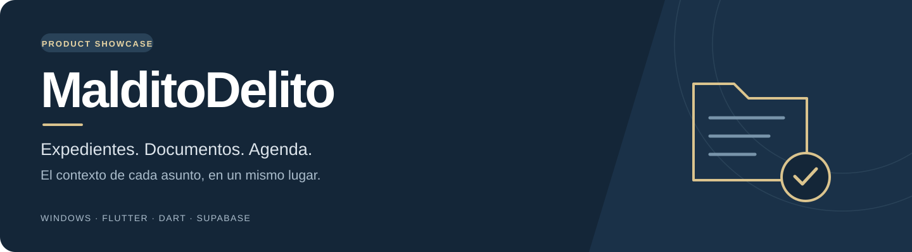
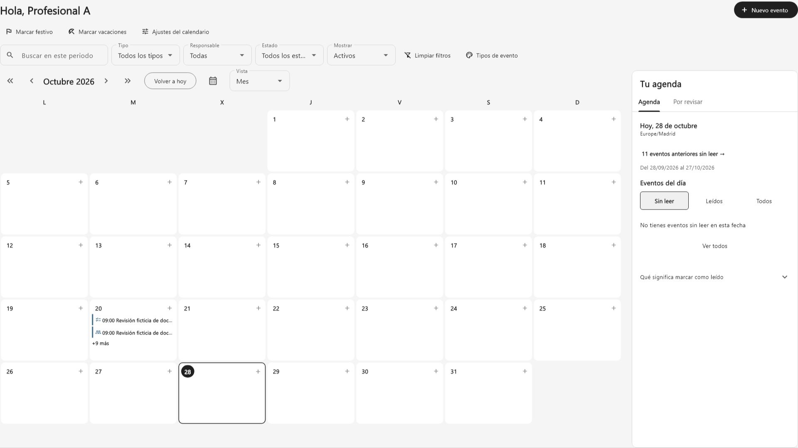
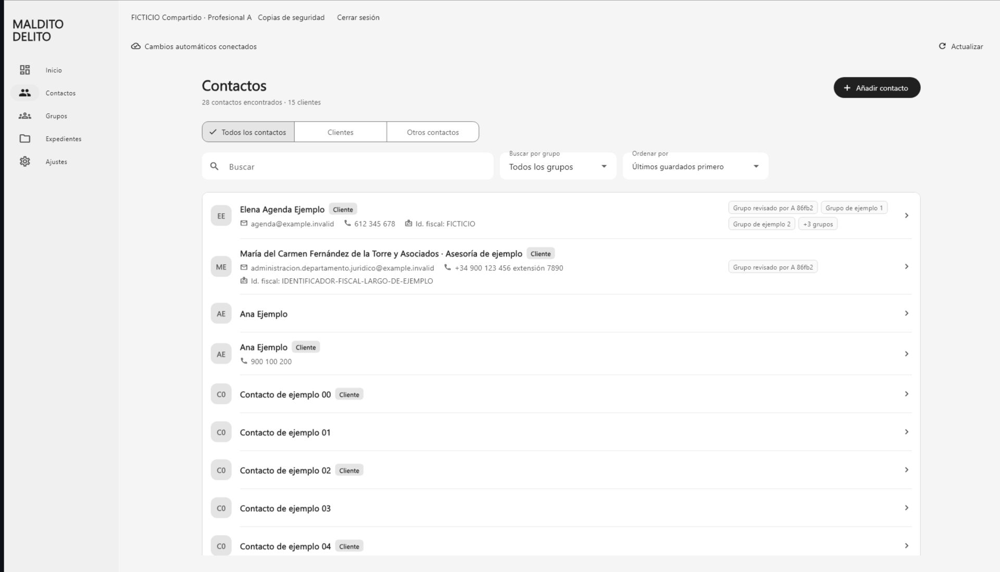
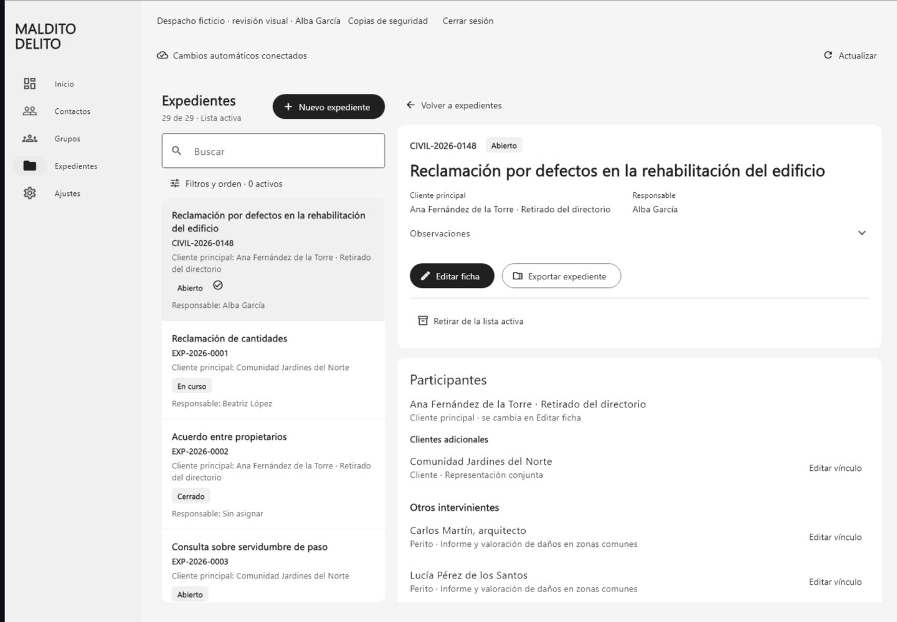

  

  <strong>El contexto de cada asunto, en un mismo lugar.</strong> 
  Aplicación de escritorio para organizar el trabajo de pequeños despachos y avanzar hacia la gestión de comunidades de propietarios.

  <a href="README.en.md">English</a> ·
  <a href="docs/GALERIA.md">Galería</a> ·
  <a href="docs/ARQUITECTURA.md">Arquitectura</a> ·
  <a href="docs/ROADMAP.md">Hoja de ruta</a>

---

## Qué es MalditoDelito

MalditoDelito nace de una necesidad concreta: reunir contactos, expedientes, documentos y fechas de trabajo en una herramienta pensada para el día a día de un despacho pequeño. Su desarrollo parte de flujos reales de organización, con pruebas sobre datos ficticios.

La propuesta combina una interfaz de escritorio en español con relaciones explícitas entre personas, asuntos, actuaciones y documentos. El objetivo es reducir búsquedas dispersas y conservar el contexto y el historial cuando cambia la información.

**Estado: desarrollo temprano activo.** Windows es la plataforma actual. Este repositorio es el escaparate público del producto: contiene presentación, imágenes de demostración y documentación de alto nivel. El código fuente de la aplicación se mantiene privado y no se distribuye aquí un instalador.

## Un recorrido de trabajo

1. **Localizar a la persona.** Buscar un contacto, consultar su ficha y sus grupos.
2. **Abrir el asunto.** Reunir participantes, observaciones y actuaciones en un expediente con su numeración.
3. **Ordenar la documentación.** Clasificar documentos, conservar sus versiones y descargar los archivos necesarios.
4. **Preparar el día.** Consultar agenda, eventos recurrentes y asuntos por revisar.
5. **Conservar una referencia.** Exportar un expediente o consultar y comparar una copia histórica.

## Funcionalidades y estado

**Integrado** significa incorporado a la rama principal de desarrollo; no equivale a una versión comercial ni a aceptación completa del piloto.

| Área | Qué aporta | Estado a 29/10/2026 |
| --- | --- | --- |
| Contactos y grupos | Directorio con búsqueda, filtros, clasificación, fichas y retirada recuperable; conservación de vínculos históricos. | Integrado |
| Expedientes | Personas relacionadas, notas, actuaciones, responsable opcional y numeración anual común por despacho. | Integrado |
| Documentos y versiones | Archivos privados, versiones anteriores, clasificación Extrajudicial/Juzgado y descargas seleccionadas. | Integrado |
| Agenda | Vistas Mes/Semana/Día/Agenda, recurrencias, excepciones, filtros y revisión personal. Avisos con la aplicación abierta. | Integrado |
| Trabajo compartido | Autenticación, permisos por espacio de trabajo, actualizaciones mediante Realtime y control de conflictos al guardar. | Integrado |
| Exportación | Expediente completo en ZIP con documentos, versiones, manifiesto y una consulta HTML legible. | Integrado |
| Copias y consulta histórica | Copias manuales, consulta local, comparación de solo lectura y extracción de versiones. | Parcial: recuperación integral pendiente |
| Comunidades de propietarios | Comunidades, inmuebles, propietarios/ocupantes, historial, reuniones, actas y versiones documentales. | Implementado en rama de revisión; pendiente de integración |
| Economía, servicios e incidencias | Control económico, proveedores, contratos, renovaciones, siniestros y obras. | Planificado |
| Asistencia con IA | Posible ayuda para consultar, resumir y preparar borradores, con revisión humana. | Dirección futura; no implementada |

## Una mirada a la interfaz

*Agenda e información personal de revisión. Imagen de una iteración de desarrollo del 28/10/2026, obtenida a partir de un render de widgets con datos ficticios. La interfaz sigue evolucionando.*

Consulta la [galería y la procedencia de las imágenes](docs/GALERIA.md).

| Contactos | Expedientes |
| --- | --- |
|  |  |

*Iteraciones de desarrollo del 25 y 26/10/2026, respectivamente.*

## Decisiones que definen el proyecto

- **Contexto conectado.** Personas, documentos y actuaciones se consultan desde el asunto al que pertenecen.
- **Historial explícito.** Una nueva versión documental o la retirada de un contacto no deben borrar silenciosamente la historia del expediente.
- **Guardados con control de conflictos.** Los cambios concurrentes requieren revisión; los reintentos conservan la identidad de la operación.
- **Salidas legibles.** Exportar permite consultar una instantánea del expediente y sus archivos fuera de la aplicación.
- **Permisos en el servidor.** El acceso compartido se delimita por espacio de trabajo y membresía, además de la interfaz.
- **Desarrollo por entregas comprobables.** Se distinguen implementación, pruebas automatizadas, integración y aceptación humana.

## Base tecnológica

| Capa | Tecnología |
| --- | --- |
| Aplicación de escritorio | Flutter y Dart |
| Acceso compartido | Supabase Auth |
| Datos compartidos | PostgreSQL, políticas RLS y operaciones transaccionales |
| Documentos compartidos | Supabase Storage privado y verificación de integridad |
| Actualización entre sesiones | Supabase Realtime y nuevas lecturas autorizadas |
| Modalidad individual | SQLite y documentos locales, independientes del espacio compartido |
| Núcleo de copias y herramientas | Python |
| Plataforma actual | Windows |

La modalidad individual y la compartida son almacenes independientes: no se presenta una sincronización offline entre ambas. El uso compartido necesita conexión para guardar. Flutter ofrece una base multiplataforma, pero este escaparate no anuncia versiones disponibles para macOS, Android o iOS.

Más detalle en la [arquitectura pública](docs/ARQUITECTURA.md).

## Desarrollo y próximos pasos

La prioridad es consolidar recorridos completos y preservar datos, documentos e historial al ampliar cada módulo. La siguiente etapa reúne la revisión de Comunidades, las ampliaciones funcionales y las comprobaciones de recuperación, protección local e instalación necesarias para un piloto.

La futura integración de IA se plantea como asistencia supervisada. Su alcance, arquitectura, permisos y coste siguen por definir; no existe actualmente una conexión de IA activa en el producto.

La [hoja de ruta](docs/ROADMAP.md) distingue lo integrado, lo que está en revisión y lo previsto, sin comprometer fechas de lanzamiento.

## Alcance de esta presentación

El producto todavía no se ofrece como una solución lista para producción. Se trabaja con datos ficticios mientras se completan las comprobaciones de recuperación, acceso, protección e instalación. Las pruebas existentes no sustituyen un piloto ni acreditan por sí solas una certificación o conformidad normativa.

Este repositorio no contiene código privado de la aplicación, configuraciones de despliegue, credenciales, bases de datos, documentos de clientes ni copias del despacho. Las imágenes son material de demostración, no expedientes reales.

## Autor y contacto

Proyecto creado y dirigido por **[Diego de Arriba](https://github.com/DiegoARRFRA)**.

Para sugerencias sobre el producto o esta presentación, puedes abrir una [issue pública](https://github.com/DiegoARRFRA/malditodelito-showcase/issues). No incluyas datos personales, documentación de clientes ni credenciales.

El acceso público a esta presentación no convierte el producto en software de código abierto. Consulta [NOTICE.md](NOTICE.md).

---

*Última revisión de esta presentación: 29 de octubre de 2026.*
