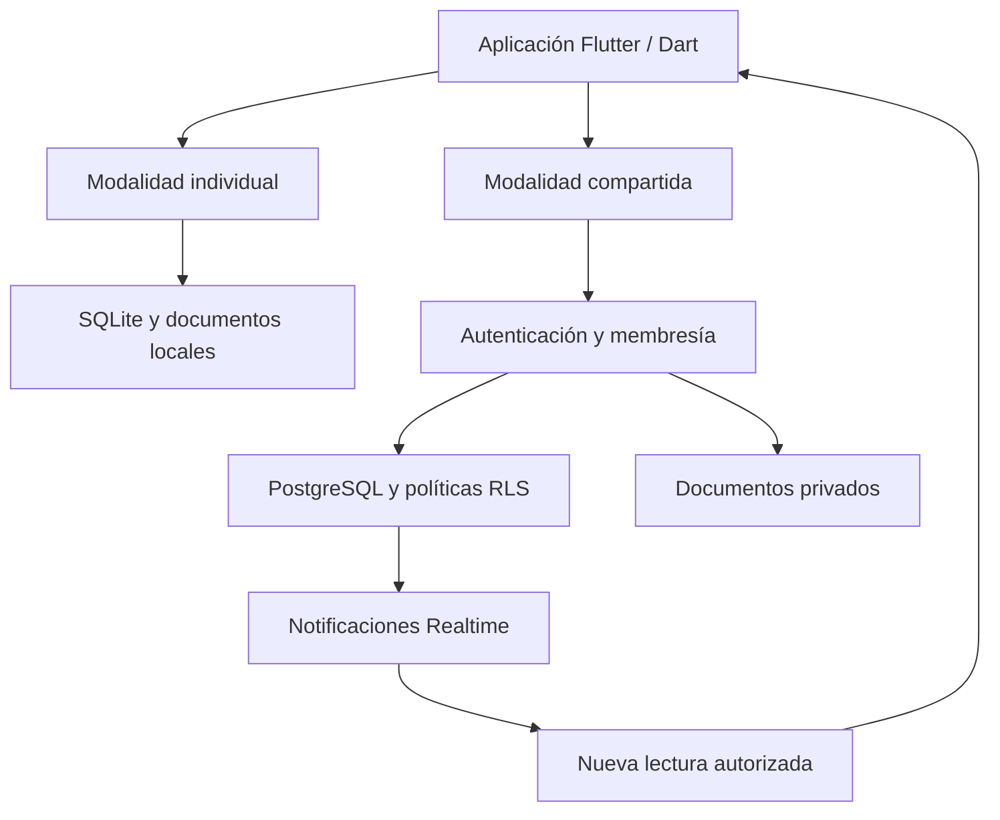

# Arquitectura de alto nivel

[Volver a la presentación](../README.md)

MalditoDelito combina una aplicación Windows en Flutter/Dart con dos modalidades de almacenamiento independientes. Esta descripción resume la arquitectura implementada sin publicar código, endpoints ni configuración del despliegue.

## Dos modalidades independientes

| Modalidad | Datos | Documentos | Conectividad |
| --- | --- | --- | --- |
| Individual | SQLite local | Archivos locales | Operación local |
| Compartida | PostgreSQL con Supabase Auth y RLS | Storage privado | Conexión necesaria para guardar |

No existe migración automática, doble escritura ni sincronización offline entre ambas modalidades. La consulta local de una copia histórica tampoco crea un nuevo despacho activo.

El diagrama es conceptual: Realtime comunica cambios, pero no sustituye la autorización de las lecturas posteriores.

## Relaciones, historial y concurrencia

Los espacios de trabajo delimitan los datos compartidos y las relaciones entre entidades. La pertenencia a un grupo de contactos es organizativa: no concede permisos sobre el despacho.

Cada guardado compartido comprueba la versión esperada. Si otra sesión ha cambiado la información, la interfaz conserva el borrador y solicita una revisión explícita. Las operaciones identificadas permiten reintentar una respuesta incierta sin duplicar la mutación.

Retirar un contacto del uso activo no borra los expedientes relacionados. Las asociaciones históricas conservan su contexto. Las versiones documentales se preservan sin sustituir silenciosamente el archivo anterior.

## Documentos privados

La carga de un documento distingue reserva, subida, comprobación y confirmación. PostgreSQL y el almacenamiento de archivos no comparten una única transacción; por eso una subida interrumpida no debe presentarse como completada.

La aplicación comprueba integridad y permisos en los flujos de descarga y exportación. Esta descripción de diseño no equivale a una auditoría o certificación de seguridad.

## Tres salidas con objetivos distintos

| Salida | Para qué sirve | Límite |
| --- | --- | --- |
| Descargar documentos | Guardar una o varias versiones para consultarlas fuera de la aplicación. | Editar la descarga no actualiza el original compartido. |
| Exportar un expediente | Reunir una instantánea legible, manifiesto y todas las versiones incluidas por el contrato de exportación. | No es un paquete de restauración. |
| Crear y consultar una copia | Conservar una referencia histórica, compararla y extraer archivos. | No acredita recuperación integral ni restauración remota. |

El núcleo de copias y consulta local utiliza Python. La protección vinculada a Windows no se presenta como garantía de recuperación en otro equipo.

## Verificación y madurez

El desarrollo cuenta con pruebas unitarias, de widgets, de integridad y de integración con autenticación real, además de comprobaciones de paquetes Windows. Sus resultados se interpretan según el entorno: una prueba automatizada de un componente no acredita un recorrido humano completo.

La validación integral de recuperación, el piloto en varios equipos, la revisión completa de protección y la entrega mediante instalador siguen pendientes. Este escaparate no publica credenciales, entornos internos, registros operativos ni cifras de pruebas como garantía comercial.
